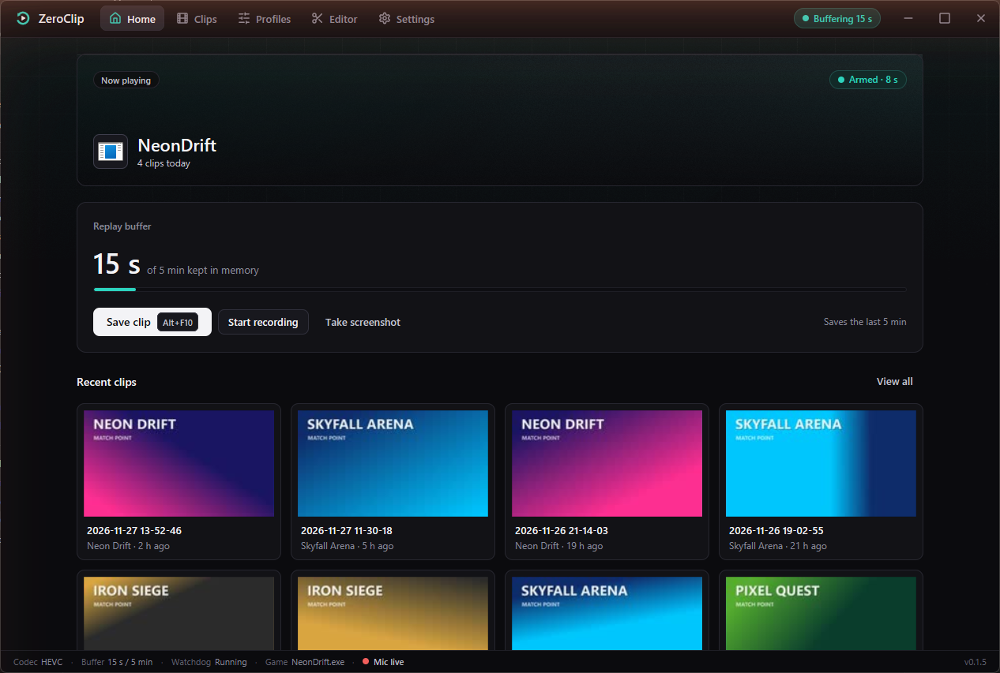
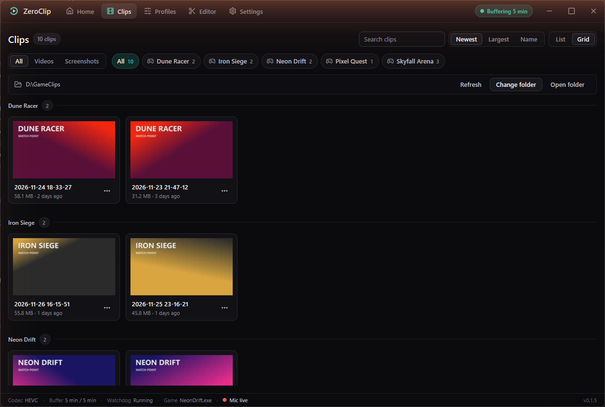
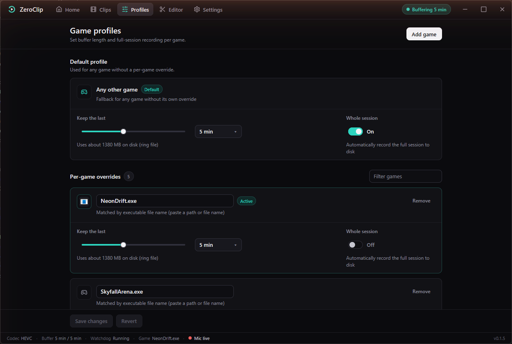
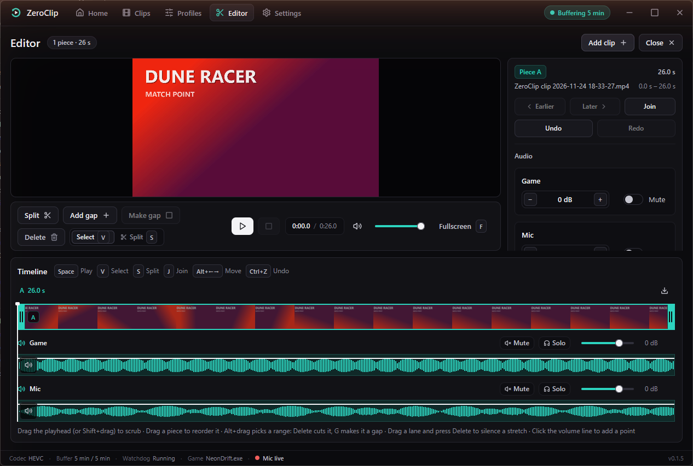
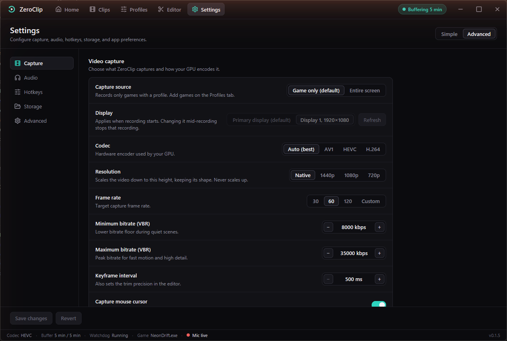

# ZeroClip

**Missed an amazing play? Press a key and it's saved.**

ZeroClip quietly keeps the last few minutes of your game. When something worth keeping
happens, press **Alt+F10** and those minutes become a clip. No need to start recording
beforehand.

Free for personal use, Windows only.

> **Early release (v0.1).** It works well on our PCs but hasn't been tested on many
> other machines yet. If something breaks, please
> [open an issue](https://github.com/zeroclip-dev/zeroclip/issues).

## Screenshots

**Home.** The replay buffer, one button to save a clip, and your latest clips.



**Clips.** Every clip and screenshot, grouped by game, with search, sorting and a list or grid view.



**Profiles.** Choose how much to keep and whether to record the whole session, per game.



**Editor.** Preview a clip, then trim, split, reorder and mix its tracks without re-encoding.



The timeline shows thumbnails and the audio waveform, with per-track volume and one-click export.

**Settings.** Capture source, codec, resolution, frame rate, audio, hotkeys and storage.



## Get started

1. Download the latest `ZeroClip-vX.Y.Z-setup-x64.exe` from
   [Releases](https://github.com/zeroclip-dev/zeroclip/releases) and run it. It installs for your
   user only (no admin) and adds a Start menu entry. Prefer no installer? Take the `.zip`, unzip
   it anywhere and run `zeroclip.exe`.
2. Windows may show a SmartScreen warning because the app isn't code-signed yet: click
   **More info → Run anyway**.
3. Start a game, play, and press **Alt+F10** when something good happens.

Your clips show up in the **Clips** tab. ZeroClip lives in the system tray while it runs.

ffmpeg, which the editor, thumbnails and smooth-seeking clips use, is not in the installer or the zip (it is
GPL, so ZeroClip doesn't ship it). ZeroClip asks you to get it: press **Download ffmpeg** in Settings > Editor
to fetch the pinned upstream build next to ZeroClip (checked against its SHA-256), or install your own and set
its path there. Recording and saving clips work without it.

## Hotkeys

| Key | What it does |
|---|---|
| **Alt+F10** | Save the last few minutes as a clip |
| **Alt+F9** | Start or stop a normal recording |

There are also hotkeys for screenshots, bookmarks and push-to-talk. To change any of them, open
**Settings → Hotkeys**, click the field and press the keys you want.

## What it can do

- **Saves the moment after it happens.** Set how many minutes to keep, per game if you like.
- **Uses your graphics card's video encoder** (HEVC or H.264), so the heavy lifting stays off
  your CPU.
- **Separate audio tracks.** Game sound, your microphone (always on or push-to-talk) and a full
  mix are kept on separate tracks, so you can turn your voice down later. On Windows 11 it can
  also record specific apps, such as Discord, on their own track.
- **Clip library.** Browse clips and screenshots, filter by game, and play them in the built-in
  player.
- **Editor.** Trim, split, reorder, add black gaps, and set the volume of each track. Exports
  are near-instant because the video isn't re-encoded.
- **Crash-safe.** If a game crashes, ZeroClip saves what it had and asks whether to keep it. A
  recording cut short by a crash is repaired the next time ZeroClip starts.
- **Popups that stay out of your clips.** Short notices confirm a saved clip or warn you when
  something fails. They never show up in the recording.
- **Updates itself, when you say so.** It tells you when a new version is out. It installs only
  when you click, never while you're recording, and checks the download first. You can turn
  this off in Settings.

**Coming later:** one-click sharing to Discord and YouTube.

**Good to know:** web browsers and Discord play only the first audio track (the full mix). To
hear the separate game and mic tracks, use a player such as VLC.

## Requirements

- Windows 10 (version 1903) or Windows 11. Recording single apps needs Windows 11.
- A graphics card with a hardware video encoder: most NVIDIA, AMD and Intel GPUs from the last
  several years. Which GPUs work hasn't been tested widely yet.

## Check your download (optional)

Each release lists the SHA-256 hash of every file in `SHA256SUMS.txt`. To compare them:

```powershell
(Get-FileHash .\ZeroClip-v0.1.0-windows-x64.zip -Algorithm SHA256).Hash.ToLower()
Select-String 'windows-x64.zip' .\SHA256SUMS.txt
```

If the two match, the download is complete and undamaged. This doesn't prove who made the file;
for that, every release also has a GitHub build attestation that you can check with
`gh attestation verify <file> --repo zeroclip-dev/zeroclip`.

## For developers

ZeroClip is written in Rust. It captures with Windows.Graphics.Capture, encodes with Media
Foundation, and uses GPUI for its interface.

To build it, you need Rust 1.95 or newer ([rustup](https://rustup.rs)), the MSVC build tools
(the *Desktop development with C++* workload) and the Windows SDK, whose `fxc.exe` the UI's
shader build uses.

```powershell
cargo run --release
cargo clippy --workspace --all-targets -- -D warnings
cargo test --workspace
```

## License

ZeroClip is **source-available** under the [PolyForm Noncommercial License 1.0.0](LICENSE), with
one extra permission and a few extra terms:

- ✅ You can use it for free, read and change the code, and **make money from the videos,
  clips and streams you record with it**.
- ❌ You can't sell ZeroClip, sell software built from its code, or put either into a
  commercial product.
- ❌ You can't rename or rebrand it, or present it as your own project. A changed version
  keeps the ZeroClip name and credit and says it is modified.
- ❌ The ZeroClip name and logo aren't licensed for your own use.

This is a summary; [LICENSE](LICENSE) has the exact terms.

## Contributing

Bug reports and ideas are welcome in [Issues](https://github.com/zeroclip-dev/zeroclip/issues).
For anything bigger than a bug fix, please open an issue first. Pull requests need a signed
[CLA](CLA.md); a bot on your pull request walks you through it. See
[CONTRIBUTING.md](CONTRIBUTING.md) and [AGENTS.md](AGENTS.md).
