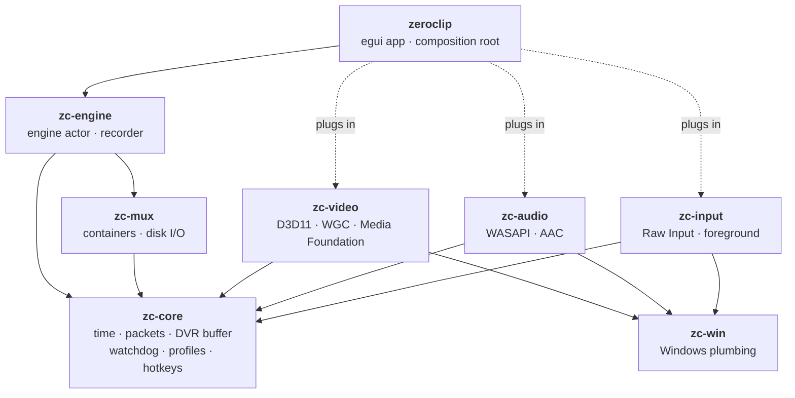

# ZeroClip

**A zero-impact game clipper for Windows, written in Rust.** ZeroClip keeps the last
few minutes of gameplay in memory and saves them with one hotkey — without touching
the game, without copying frames off the GPU, and without losing the clip when the
game crashes.

> **Status: pre-alpha.** The app captures the screen and encodes it on the GPU (H.264 or
> HEVC, 60 fps, fixed keyframe interval), surviving alt-tab, resolution and display changes.
> It doesn't save clips yet: audio and hotkeys (Phase 2) and the DVR buffer and files
> (Phase 3) come next. See the [roadmap](docs/ROADMAP.md).

## What makes it different

ShadowPlay, ReLive, Game Bar, OBS and Medal already exist. ZeroClip is about doing the
systems work properly:

- **Anti-cheat safe by construction.** Only public OS APIs — Windows.Graphics.Capture,
  WASAPI, Raw Input. No DLL injection, no memory reading, no `SetWindowsHookEx`.
- **Zero-copy capture.** Frames go from the compositor to the hardware encoder without
  leaving VRAM. Only compressed data reaches system RAM.
- **A GOP-aware DVR buffer.** The rolling buffer evicts whole GOPs, so every saved clip
  starts on a keyframe and decodes; audio is evicted in step, so clips are never silent.
- **Crash-survivable files.** Recordings use fragmented containers that stay playable if
  the game — or ZeroClip — dies mid-write.
- **A watchdog that is a state machine,** not a retry loop: drain → flush → re-init →
  resume, stepping down the codec ladder (AV1 → HEVC → H.264) when a GPU can't cope.
- **Instant editing.** Trim and stitch by stream copy, with no re-encode; keyframe snap
  points are shown on the timeline.
- **One-drop sharing.** Drag a clip onto Discord or YouTube and the link lands in your
  clipboard.

The full design and the reasoning behind each choice: [docs/DESIGN.md](docs/DESIGN.md).

## Architecture at a glance



The engine and everything beneath it is platform-independent and tested with
synthetic streams. The Windows crates are adapters that implement the engine's
ports; the app plugs them in. Later phases add `zc-store` (SQLite metadata),
`zc-editor` (stream-copy trim/stitch via the ffmpeg CLI) and `zc-destinations`
(Discord, YouTube). Details: [docs/ARCHITECTURE.md](docs/ARCHITECTURE.md).

## Getting started

You need:

- Windows 10 1903 or later (Windows 11 for per-game audio capture).
- A GPU with a hardware video encoder — any NVIDIA, AMD or Intel GPU from roughly the last eight years.
- Rust 1.95 or newer, installed with [rustup](https://rustup.rs), plus the MSVC build tools: Visual
  Studio Build Tools with the **Desktop development with C++** workload (rustup offers to install them).
- From Phase 5: `ffmpeg` on your `PATH`.

```powershell
cargo run                    # the app (the UI works; recording arrives phase by phase)
cargo test                   # everything that is built so far
cargo test -- --ignored      # the specs for what isn't built yet (these fail until implemented)
cargo run -p spike-phase0    # the Phase 0 capture → encode spike
```

## How the work is organised

Behaviour that is designed but not yet built is written down as tests marked
`#[ignore = "spec: …"]`, next to the code they describe — the DVR buffer, the watchdog,
the hotkey matcher, and more. Building a feature means removing the `ignore` and
making the spec pass. Phases, and what "done" means for each, are in
[docs/ROADMAP.md](docs/ROADMAP.md); settled choices are recorded in
[docs/DECISIONS.md](docs/DECISIONS.md), unsettled ones in
[docs/OPEN_QUESTIONS.md](docs/OPEN_QUESTIONS.md).

## License

Copyright © 2026 0xtikaa. ZeroClip is free to use under the
[PolyForm Noncommercial License 1.0.0](LICENSE), plus one extra permission: download it,
use it, study it, change it and share it for free, and use it to make videos that earn
money. What you may not do is sell ZeroClip, or software built from its code.
