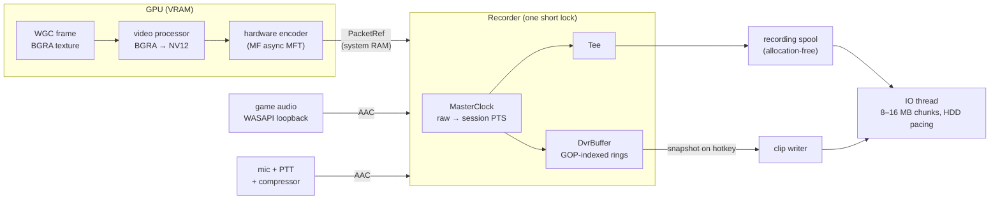
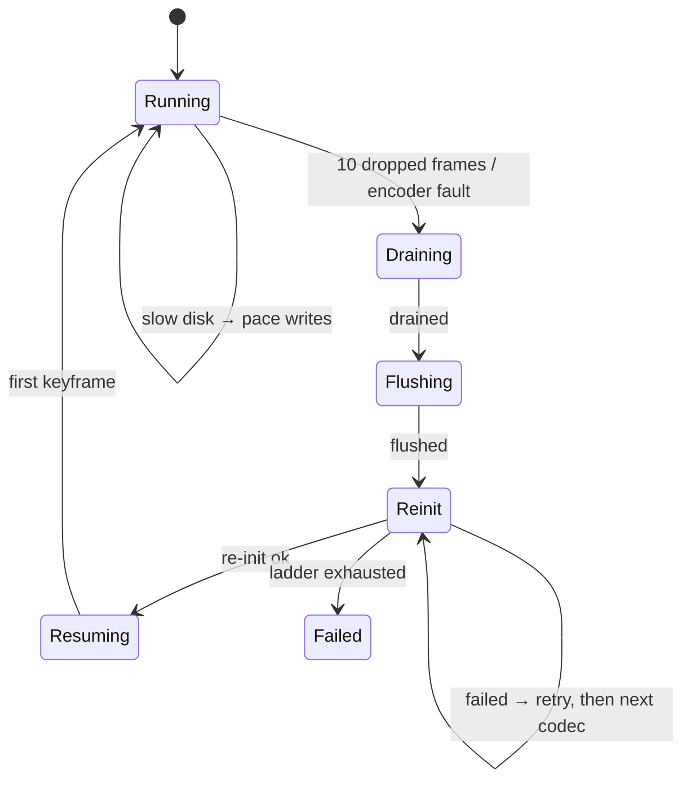

# Architecture

How the [design](DESIGN.md) maps onto code: crates, threads, data flow, and the rules
that keep it fast and testable. Read this before adding a crate or moving code
between crates. Section references like `DESIGN §4` point into DESIGN.md.

## Principles in one breath

Capture is external and anti-cheat safe; frames stay on the GPU until encoded;
encoded data lives in page-locked system RAM; the DVR buffer thinks in GOPs;
recordings are fragmented so a crash never costs the file; recovery is an explicit
state machine; editing never re-encodes; nothing is ever deleted unverified.

## Crates

| Crate | Owns | Depends on | OS |
|---|---|---|---|
| `zeroclip` (repo root) | GPUI UI, settings file, logging, **wiring** (composition root) | `zc-engine`, `zc-core`, `zc-mux`, `zc-video`, `zc-win` (drive probe, page-locking); more adapters as phases land | Windows |
| `zc-engine` | the engine actor, recording modes, the `Recorder`, the disk-backed DVR ring (`disk_dvr.rs`, D32 Disk mode), synthetic sources | `zc-core`, `zc-mux` | any |
| `zc-core` | `Hns` time, packets, codecs, DVR buffer, watchdog FSM, profiles, hotkeys, DSP, settings, **ports** | — | any |
| `zc-mux` | container writers (fMP4/MKV), chunked writes, HDD pacing | `zc-core` | any |
| `zc-video` | D3D11 device, WGC capture, BGRA→NV12, MF hardware encoder, screenshots | `zc-core`, `zc-win` | Windows |
| `zc-audio` | WASAPI process loopback, mic + push-to-talk, MF AAC encoder | `zc-core`, `zc-win` | Windows |
| `zc-input` | Raw Input hotkeys, foreground-window tracking | `zc-core`, `zc-win` | Windows |
| `zc-win` | COM/MF lifetimes, QPC clock, message-only window thread, drive detection, page-locking | `zc-core` | Windows |
| `zc-store` | SQLite metadata: clips, keyframes, profiles, probe cache, waveforms, uploads | `zc-core` | any |
| `zc-editor` | keyframe snapping, stitch compatibility, waveform peaks, ffmpeg CLI jobs | `zc-core` | any* |
| `zc-destinations` | the `Destination` trait, Discord webhooks, YouTube (BYO credentials) | `zc-core` | any |
| `spike-phase0` | throwaway Phase 0 proof: WGC → MF → MP4 | `zc-win` | Windows |

\* runs `ffmpeg.exe` as a separate process.

### Dependency rules

1. **`zc-core` and `zc-engine` never depend on `windows`.** The whole recording engine —
   buffers, modes, watchdog, hotkeys, profiles — builds and tests on any OS in seconds.
2. **Adapters depend on `zc-core`, never on `zc-engine`.** They implement the port
   traits in `zc_core::ports` (`VideoSource`, `AudioSource`, `InputSource`) and push
   packets into a `zc_core::sink::PacketSink`.
3. **Only the app knows everyone.** `src/wiring.rs` constructs the Windows adapters and
   hands them to the engine. Tests hand the engine synthetic sources instead.
4. **FFmpeg is a process, not a library** (`zc-editor`). Its licensing never touches ours.
5. New external crates go in `[workspace.dependencies]` in the root `Cargo.toml`.

## Threads

| Thread | Owner | Does | Must never |
|---|---|---|---|
| UI | GPUI | draws; sends `Command`s; drains `EngineEvent`s | block on the engine |
| `zc-engine` | engine actor | owns settings, profile, watchdog, modes; starts/stops sources | touch the hot path |
| WGC frame pool | `zc-video` | pace to the target fps, convert to NV12, hand the ring slot to the encoder thread | allocate, block |
| Encoder (`zc-video` thread) | `zc-video` | NeedInput → `ProcessInput`; HaveOutput → `ProcessOutput` → `PacketSink::push`; repeat the last frame while the screen is static | allocate, block on I/O |
| `zc-game-audio`, `zc-mic`, one per app track (up to 6 source tracks) | `zc-audio` | WASAPI event loop → `SampleTimeline` → AAC → `PacketSink::push` (MMCSS "Pro Audio"); the mic applies the PTT gate and compressor; both reopen a lost device; each also writes its PCM into the Master `MixBus` | allocate, block on I/O |
| `zc-master-mix` (Master, D30, audio track 1) | `zc-audio` | every 20 ms: mix the `MixBus` up to 200 ms behind real time → AAC → `PacketSink::push` (MMCSS "Pro Audio") | allocate, block on I/O, hold the bus lock across an encode |
| `zc-input` (message thread) | `zc-input` | Raw Input + WinEvent hook → `OsEvent`s; never logs keystrokes | do real work in callbacks |
| IO | engine (Phase 3) | one thread per clip dump and per recording (chunked writes; dumps paced on HDD); in disk mode a dump also reads the ring file record by record | hold the recorder lock |
| `zc-io-ring` (disk mode, D32) | `zc-engine` (`disk_dvr.rs`) | every 250 ms: copy finished GOPs out of the staging `DvrBuffer` in short holds, write each as one record to `zeroclip-dvr.ring` (paced on HDD) | hold the recorder lock across a write |
| tokio pool | app (Phase 5–6) | uploads, waveform extraction, ffmpeg jobs | — |

## Data flow

- **Packets bypass the engine's inbox.** Sources call `PacketSink::push` directly; the
  inbox carries only control traffic (commands, OS events, health signals).
- **Borrowed on the hot path.** A `PacketRef` borrows the encoder's bytes; sinks copy
  them into memory they pre-allocated. Owned `Packet`s exist only off the hot path
  (snapshots, tests).
- **One encode, many sinks.** The `Tee` fans packets out to whichever writers are
  active. A manual recording runs Tee → spool → IO thread, so DVR and recording run together (DESIGN §5).

## Time

Everything is `zc_core::Hns` — 100 ns ticks, the unit of WGC `SystemRelativeTime`,
WASAPI `u64QPCPosition` and Media Foundation sample times. No conversions, no drift.

Sources stamp packets with **raw** QPC-based capture time. The `Recorder` owns the
`MasterClock`: it anchors on the first video keyframe and maps every track onto the
session timeline, applying constant per-track offsets (e.g. mic limiter lookahead).
The anchor survives encoder re-inits, so PTS never restarts at zero (DESIGN §6, §8).
Audio sources keep sample-exact timestamps but let `SampleTimeline` re-align them to QPC
when the sound card's clock drifts more than 20 ms (DESIGN §6).

Encoders run without B-frames, so decode order equals presentation order and packets
carry only a PTS.

## Control flow

- **UI → engine:** `zc_core::control::Command` (save clip, toggle recording, screenshot,
  push-to-talk, apply settings, shutdown) over a channel.
- **Engine → UI:** `EngineEvent` (status, clip saved, warnings, …) over a channel, plus a
  `wake` callback that makes GPUI repaint — GPUI sleeps otherwise, which is how the UI
  costs nothing while a game runs.
- **Input → engine:** `OsEvent::Key` goes through the `ChordMatcher` (in `zc-core`) and
  becomes commands; `OsEvent::Foreground` goes through `ProfileSet::resolve` and
  `clamp_window`, then resizes the DVR buffer between GOPs.

## The watchdog

Pure logic in `zc_core::watchdog`: the engine feeds it `HealthEvent`s and performs the
`WatchdogAction`s it returns (DESIGN §8).

## Files and modes

| Mode | Trigger | Path | Container |
|---|---|---|---|
| DVR clip | hotkey | snapshot of `DvrBuffer` → clip writer. Disk mode (`disk_dvr.rs`): staged part copied first, then the ring file's records are streamed into the writer one at a time | fMP4 |
| Manual | hotkey toggle | `Tee` → session writer | fMP4 |
| Session | game profile | `Tee` → session writer, for the life of the game | fMP4 |
| Screenshot | hotkey | one texture → staging → PNG | PNG |
| Crash rescue | game died unexpectedly | `DvrBuffer` (disk mode: its staged part, then the ring file streamed on the IO thread) → `recovery.tmp` → prompt | fMP4 |
| Recording file | while a recording runs | spool → IO thread → `<name>.mp4.partial`, synced per fragment | fMP4, renamed to `<name>.mp4` when finished |
| Startup repair | app start, for each `*.partial` left behind | cut to the last complete fragment → `<name>.mp4`; never overwrites | fMP4 |

## Errors and logging

- Library crates return `thiserror` enums (`SourceError`, `DvrError`, `SinkError`, …).
  `anyhow` is only for the app and spikes.
- The hot path doesn't return errors upward; it counts them (`RecorderStats`) and reports
  health events, and the watchdog decides.
- `tracing` everywhere; daily log files in `%LOCALAPPDATA%\ZeroClip\data\logs`; panics
  are logged. `ZEROCLIP_LOG=zc_engine=trace` turns up the detail.

## Testing

| Layer | How |
|---|---|
| Pure logic (`zc-core`, `zc-mux`, `zc-editor`, …) | unit tests, and `#[ignore = "spec: …"]` tests for what isn't built |
| Hot-path discipline | `crates/zc-core/tests/dvr_no_alloc.rs` counts allocations inside `DvrBuffer::push` |
| Engine | `SyntheticVideoSource` with injected faults; `crates/zc-engine/tests/synthetic_harness.rs` |
| Windows adapters | the Phase 0 spike, then manual checks against each phase's *done when* |

CI runs formatting, clippy (`-D warnings`), tests and docs on Windows for every push.

## Where does this go?

| New thing | Goes in |
|---|---|
| A rule about packets, time, buffering or recovery | `zc-core` (with tests) |
| A new recording mode, or a new engine command | `zc-engine`, plus `zc_core::control` |
| A Windows API call | the adapter crate that owns that subsystem; shared helpers in `zc-win` |
| A new container or disk behaviour | `zc-mux` |
| A new upload target | `zc-destinations` (one `impl Destination`) |
| A setting | `zc_core::settings` with a serde default, plus a field on the Settings tab |
| A UI screen | `src/ui/` |
| A UI widget that more than one screen uses | `src/ui/components/` (one module per widget) |
