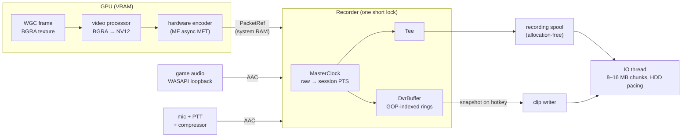

<!-- DRAFT. The author must rewrite this in their own voice before publishing. Every claim comes from DESIGN.md, ARCHITECTURE.md or DECISIONS.md; check each one. -->

# How ZeroClip works

Most clip tools face the same question: how do you keep the last minute of play without
slowing the game down? ZeroClip answers it with a few decisions that are simple to state
and easy to get wrong.

## The problem

A recorder competes with the game for the GPU, the CPU and the disk, and any of them can
cost frames. So ZeroClip keeps the work the game sees as small as possible. It captures
with public OS APIs only (Windows.Graphics.Capture, WASAPI and Raw Input). It does not
inject a DLL, read game memory or install a hook.

## Frames never leave the GPU

Each frame arrives from Windows.Graphics.Capture as a BGRA texture on D3D11
([D2](DECISIONS.md)). A video processor converts it to NV12 on the GPU, and the Media
Foundation hardware encoder compresses it ([D3](DECISIONS.md)). Only compressed packets
reach system RAM. Raw frames are much larger than the packets that come out of the
encoder, so keeping them in VRAM is the cheapest choice.

## A ring that only cuts at keyframes

The DVR buffer keeps the last few minutes of packets in RAM. It is sized for the worst
case. At a 20 Mbps maximum bitrate, the stream is 2.5 MB/s, or about 150 MB per minute
([DESIGN §4](DESIGN.md#4-memory--storage-strategy)). Sizing for the maximum means a quiet
scene leaves memory unused, and that is an accepted cost.

A naive ring drops the oldest bytes. A clip then starts in the middle of a GOP, and
roughly half of all clips would not decode. So the buffer keeps an index of GOP
boundaries (offset, timestamp and length) and evicts whole GOPs from the front. A save
walks back from the newest GOP until it covers the requested duration, then starts at
that keyframe.

Audio follows the same rule. Two AAC tracks at 192 kbps are about 48 KB/s, so five minutes
of audio is roughly 14 MB, against 750 MB of video. When a GOP is evicted, audio older than
that GOP's start time goes with it, so a clip is never silent. The first audio track is a
live master mix of the game, mic and app sources ([D30](DECISIONS.md)). A player that
plays only the first track still hears everything.

Time is one unit everywhere: `Hns`, 100 ns ticks. Sources stamp packets with capture time,
and the recorder maps every track onto one session timeline. Audio is sampled exactly, and
it is re-aligned to the QPC clock when the sound card drifts more than 20 ms
([DESIGN §6](DESIGN.md#6-audio-pipeline)).

## No allocation on the hot path

The path from capture to encoder to `Recorder::push` runs on threads that must never
allocate, block on I/O or hold a lock across I/O. All buffers are allocated once, at
startup. A test with a counting allocator (`crates/zc-core/tests/dvr_no_alloc.rs`) fails
if a push allocates, so the rule is checked and not just promised.

Saving a clip copies the buffer, and a single long copy under the recorder lock would stall
capture. [D29](DECISIONS.md) splits the copy into short locked chunks, and detects packets
that were overwritten while it ran. The lock time for a 60 s window is
<!-- TODO measured: snapshot lock time, 60 s window -->, and for a 300 s window
<!-- TODO measured: snapshot lock time, 300 s window -->.

## Crash-safe files

A standard MP4 writes its index at the end of the file, so a crash leaves a file that
will not play. ZeroClip writes fragmented MP4 instead ([D18](DECISIONS.md)). The init
segment (`moov`) comes first, then one `moof` and `mdat` pair per GOP. Every fragment is
synced to disk before the next one is written. A recording is written to a `.mp4.partial`
file until it finishes.

If ZeroClip dies mid-recording, the next start cuts the partial file back to its last
complete fragment and keeps it. The target is that a recording killed mid-way loses about
one second. The game itself is a separate process, so a game crash loses nothing.

## Disks, and the HDD problem

2.5 MB/s is nothing for a spinning disk. The real problem is seek contention. Capture
writes and the game's asset streaming share one spindle, and both stutter. ZeroClip
buffers writes and flushes them in 8 to 16 MB chunks, which means far fewer head moves.

A clip dump is a burst. A 5-minute buffer at 20 Mbps is about 750 MB, which saturates an
HDD for roughly seven seconds ([DESIGN §4](DESIGN.md#4-memory--storage-strategy)). On a
spinning disk the dump is paced to about 30 to 50 MB/s on a low-priority IO thread. It takes
longer, but the game stays playable. On an SSD it runs at full speed. The drive type comes
from `IOCTL_STORAGE_QUERY_PROPERTY`, behind a probe in `zc-win`. The effect on frame time
and dump duration is
<!-- TODO measured: game frame time and dump duration on HDD with pacing -->.

## What is next

The watchdog is a state machine, not a retry loop. It drains, flushes, re-inits and resumes,
and it steps down the codec ladder (AV1, then HEVC, then H.264) when a GPU cannot keep up
([DESIGN §8](DESIGN.md#8-reliability--watchdogs)). It is not built yet. Per-game profiles, a
tray and the watchdog wiring come in the next phase.

After that comes the editor. Trim and stitch work by stream copy through the ffmpeg CLI,
with no re-encode, and clips go to Discord and YouTube with one drop. The full design and
the reasons behind each choice are in [DESIGN.md](DESIGN.md), and the crate layout and
threads are in [ARCHITECTURE.md](ARCHITECTURE.md).
